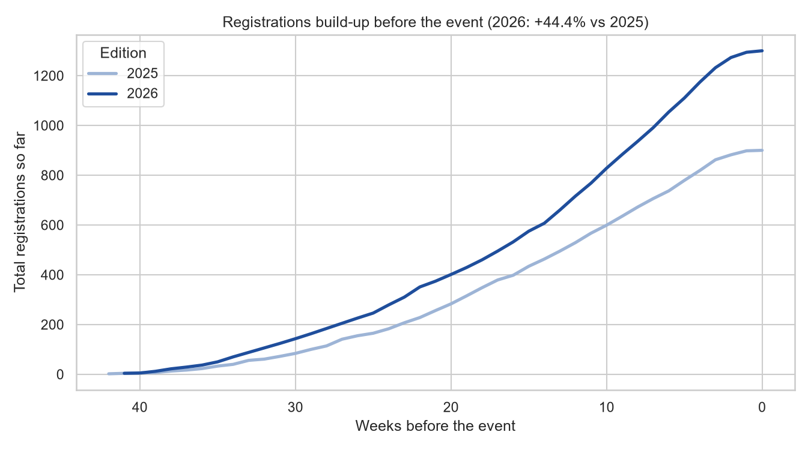
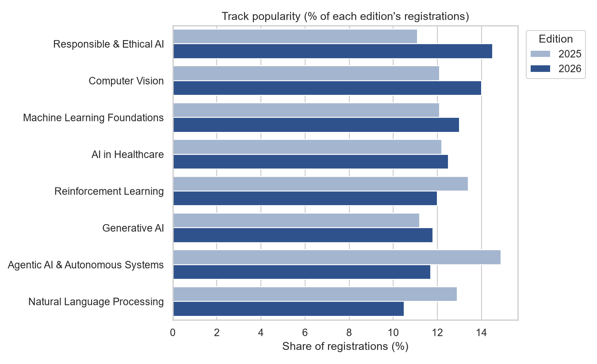
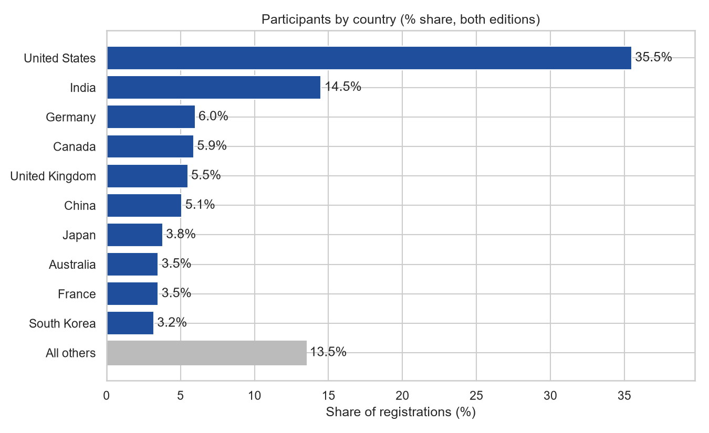
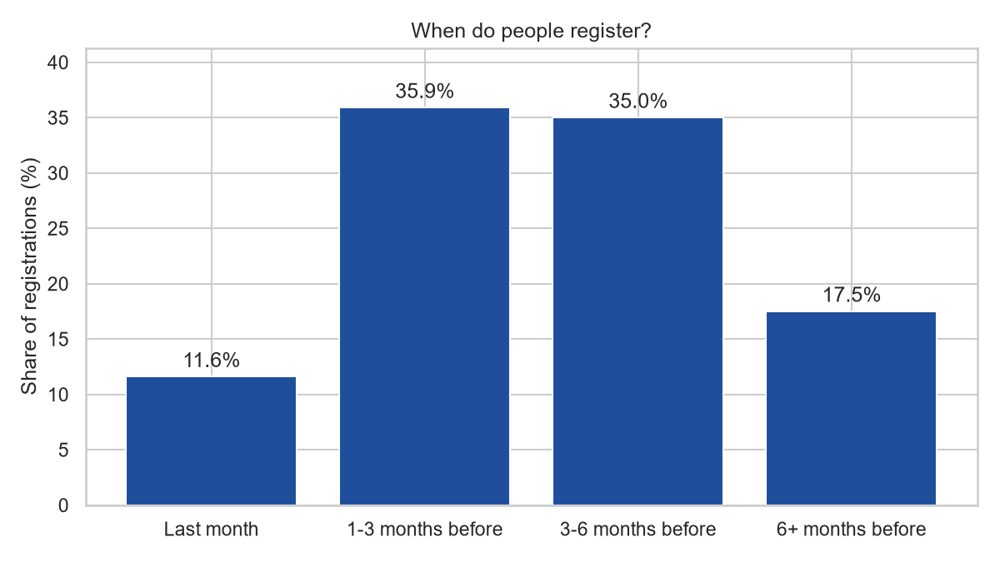
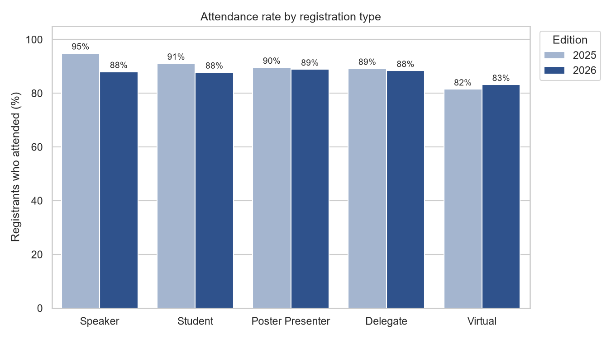

# Conference Registration Data Analysis

Analysing registration data for a fictional AI conference series (two editions,
2025 and 2026) to find trends in registrations, popular research tracks,
country participation, registration timing and attendance.

> All data in this project is **synthetic** (generated with Faker).
> No real people or contact details are included.

**Tech stack:** Python · pandas · SQLite · matplotlib · seaborn

---

## Key findings

| Question | Answer |
|---|---|
| 1. How did registrations grow? | **+44.4%**: from 900 (2025) to 1,300 (2026) |
| 2. Most popular tracks? | No clear winner: every track gets 10–15% of registrations |
| 3. Top countries? | **United States 35.5%**, India 14.5%, then Germany, Canada and the UK at ~6% each |
| 4. How early do people register? | **71%** register 1–6 months before the event; only 11.6% in the final month |
| 5. Attendance rate? | **~88%** overall; Virtual registrants attend least (82–83%) |

### 1. Registration build-up
2026 tracks close to 2025 for the first months, then pulls clearly ahead in the
last ~20 weeks before the event.



### 2. Track popularity
Shares range from about 10% to 15% per track. **Note:** the data generator
assigns tracks at random, so the differences between tracks (and between years)
are chance, not a real trend. With real data, this chart would show which
tracks to give bigger rooms or more sessions.



### 3. Participants by country
Two countries make up half of all registrations. The top 10 are shown;
the remaining 5 countries (plus 1.5% with no country given) are grouped as
"All others".



### 4. When people register
Most registrations arrive 1–6 months before the event, so that is the window
where promotion and reminder emails matter most.



### 5. Attendance by registration type
Speakers, students, delegates and poster presenters all attend at roughly
88–95%. Virtual registrants are consistently the lowest.



---

## How the analysis works

| Step | Script | What it does |
|---|---|---|
| 1 | `generate_data.py` | Creates 2,200 fake registrations, then adds realistic problems on purpose (duplicates, missing values, inconsistent spellings, broken emails) |
| 2 | `explore.py` | First look with pandas: shape, types, missing values, duplicates |
| 3 | `clean_data.py` | Fixes the problems: 2,244 raw rows → 2,200 clean rows |
| 4 | `sql_analysis.py` | Loads the clean data into SQLite and answers the 5 questions with SQL |
| 5 | `make_charts.py` | Turns the SQL results into the charts above |

### Data cleaning results
| Problem | Found | Fix |
|---|---|---|
| Duplicate registrations | 44 | Removed (matched on `registration_id`) |
| Country spelling variants (`USA`, `INDIA  `) | 15 | Merged into one standard name |
| Track case variants (`generative ai`) | 8 | Restored to the standard spelling |
| Missing country | 34 | Set to `Unknown` (row kept) |
| Broken emails | 11 | Flagged in an `email_valid` column (row kept) |

### SQL techniques used
- `GROUP BY` with `COUNT` and percentage shares
- Window functions: `LAG()` for year-over-year growth and
  `SUM(...) OVER (PARTITION BY ...)` for shares within each edition
- `CASE WHEN` to bucket registrations into time windows
- Subqueries for overall totals

All query results are saved as CSV files in [`outputs/`](outputs/).

---

## How to run

```bash
python -m venv .venv
.venv\Scripts\activate        # Windows  (macOS/Linux: source .venv/bin/activate)
pip install -r requirements.txt

python generate_data.py       # 1. create the raw data
python clean_data.py          # 2. clean it
python sql_analysis.py        # 3. run the SQL questions
python make_charts.py         # 4. draw the charts
```

## Project structure

```
conference-data-analysis/
├── data/
│   ├── registrations_raw.csv      # generated, with problems added
│   └── registrations_clean.csv    # after cleaning
├── outputs/                       # SQL results (q1 to q5 CSVs)
├── images/                        # charts used in this README
├── generate_data.py
├── explore.py
├── clean_data.py
├── sql_analysis.py
├── make_charts.py
└── requirements.txt
```

## Limitations
- The data is synthetic, so the findings show the analysis method, not real
  conference behaviour. Track choice in particular is fully random.
- Only two editions exist, so "growth" is a single year-over-year comparison.

---

Part of my 18-week AI/ML engineering portfolio.
[GitHub](https://github.com/a-venu-gopal)